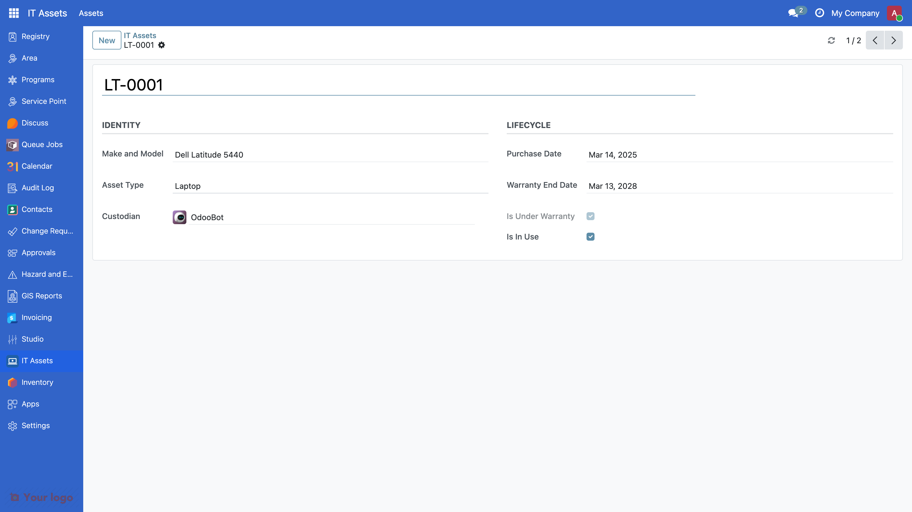
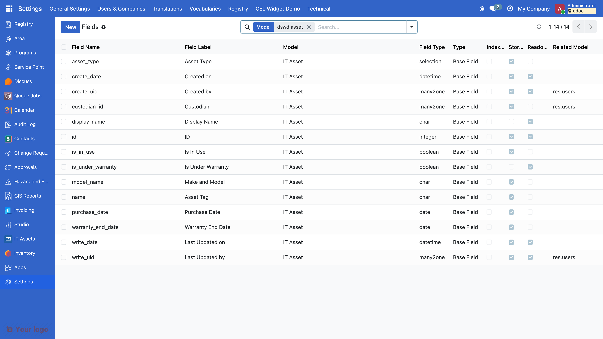
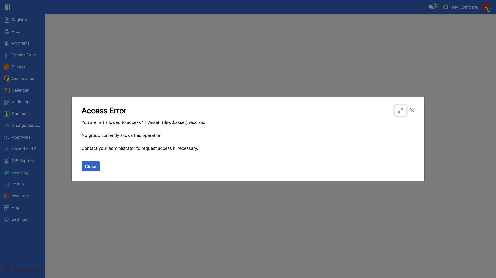
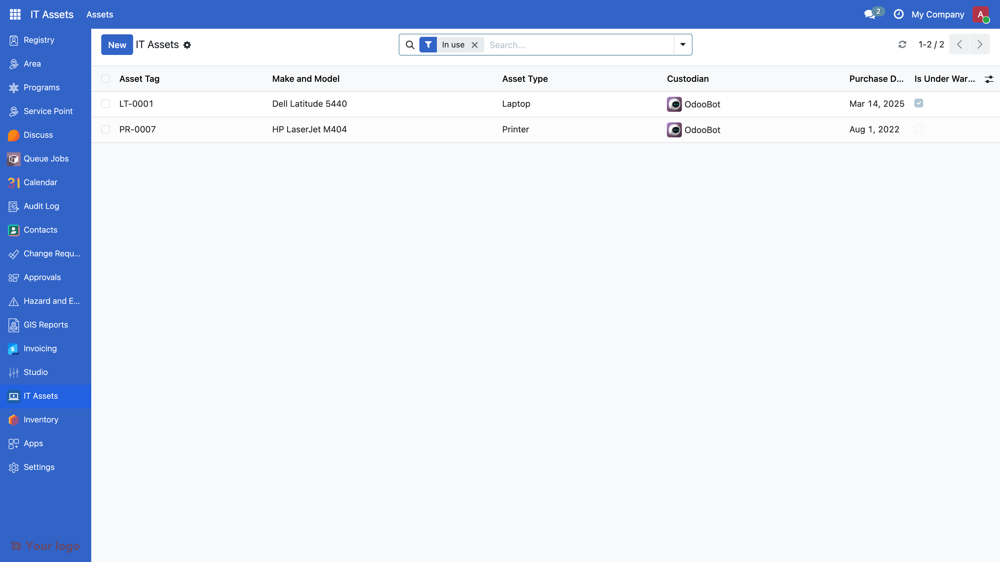
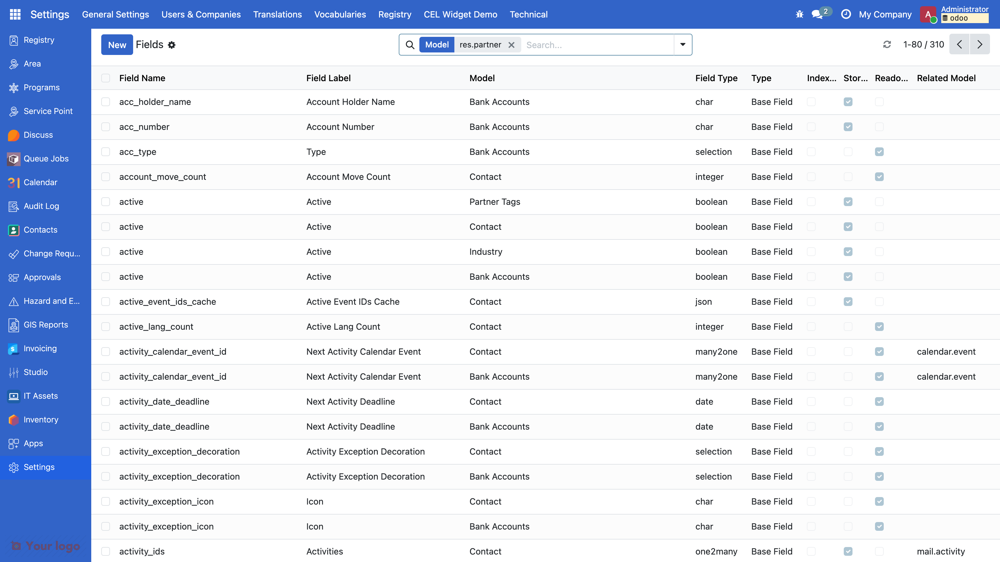

<!-- _class: lead -->
<!-- _paginate: false -->

# Module 3

## Introduction to Odoo

OpenSPP and Odoo Foundations Training, Day 2, 8:30 to 10:00

Edwin Gonzales, OpenSPP

---

<!-- _footer: "Guide 0.3" -->

## Before we start

```bash
./odoo-project start
```

Log in with `admin` / `admin`. Settings, scroll to the bottom, **Activate the developer mode**.

Then wait. Nothing before 8:50 needs your laptop.

---

<!-- _footer: "Guide 3.1" -->

## By ten you can

<style scoped>section { padding-top: 24px; padding-bottom: 48px; } section ol { font-size: 0.85em; }</style>

1. Say what Odoo is and name the three parts of MVC in Odoo terms.
2. Say what a module is, the role of each file in one, and why a file not in the manifest does not exist.
3. Write a model with Char, Selection, Date, Many2one and Boolean fields: "model = table, field = column".
4. Write a list view, a form view, an action and a menu: menu, action, view, model.
5. Write the access row a new model needs, and recognise its absence in the log and on screen.
6. Use the ORM from a method and from the shell: `search`, `browse`, `create`, `write`, `unlink`.
7. Add a PDF report and find it in the Print menu.
8. Run `./odoo-project test dswd_asset` and read the summary line.

After the break you learn why you will almost never build a module this way for 4Ps.

---

<!-- _footer: "Guide 3.2" -->

## What Odoo is

- Python on PostgreSQL, web client in JavaScript. 2005 TinyERP, then OpenERP, since 2014 Odoo.
- One major release a year. This training: **Odoo 19** (2025).
- **Community** edition, LGPL v3: what OpenSPP builds on and what you run. Enterprise: proprietary modules on top.
- Everything is a module, including the core. A module adds tables, columns, screens, menus, reports and rules to other modules **without changing their code**.
- OpenSPP: about a hundred `spp_*` modules on Odoo. Your `dswd_*` modules: on top of those.

---

<!-- _footer: "Guide 3.3" -->

## MVC, in Odoo terms

| MVC        | In Odoo                                                                                  | You write it in                                  |
| ---------- | ---------------------------------------------------------------------------------------- | ------------------------------------------------ |
| Model      | `models.Model` classes and fields; the ORM maps them to tables                           | `models/*.py`                                    |
| View       | XML on `ir.ui.view` (list, form, search, kanban), QWeb templates for reports             | `views/*.xml`, `report/*.xml`                    |
| Controller | actions and menus route clicks; model methods run the logic; HTTP controllers serve URLs | `views/*.xml`, `models/*.py`, `controllers/*.py` |

Data and rules in the model. Drawing in the view. The controller stays thin: a button calls a method, the method uses the ORM, the view only says where the button sits.

---

<!-- _footer: "Guide 3.4" -->

## Odoo in five words

| Word   | Means                                                | See it at                     |
| ------ | ---------------------------------------------------- | ----------------------------- |
| Module | a folder with `__manifest__.py` on the addons path   | Apps                          |
| Model  | a table: `_name = "dswd.asset"` becomes `dswd_asset` | Settings > Technical > Models |
| Field  | a column with a type                                 | Settings > Technical > Fields |
| View   | how the table is drawn: list, form, search           | Settings > Technical > Views  |
| Menu   | menu, then action, then view, then model             | the top bar and the app tiles |

Look at `res.partner` under Models: fields from `base`, from `spp_registry`, from `spp_vocabulary`. **Many modules add columns to one table.** Hold that thought until 10:40.

---

<!-- _footer: "Guide 3.5" -->

## What we build: an IT asset register



Fill in the file map on your handout, section 3, as we go. Every file and its role: Guide 3.5.

---

<!-- _footer: "Guide 3.6" -->

## Step 0: a module is a folder and a manifest

```python
{
    "name": "DSWD Training: IT Asset Register",
    "category": "DSWD 4Ps/Training",
    "version": "19.0.1.0.0",
    "license": "LGPL-3",
    "depends": ["base", "spp_security"],
    "data": ["security/ir.model.access.csv"],
    "application": False,
    "installable": True,
    "auto_install": False,
}
```

---

<!-- _footer: "Guide 3.6" -->

## Step 0: a module is a folder and a manifest (continued)

Abridged: the full manifest is in Guide 3.6. Odoo needs a folder and a manifest, nothing more. The `dswd_` prefix is **our** project's rule, the way `spp_` is OpenSPP's: it says who owns the code, not what it is about.

A file not listed in `data` does not exist to Odoo: no error, it is simply ignored.

**Install now:** `./odoo-project install dswd_asset`

---

<!-- _footer: "Guide 3.7" -->

## Step 1: the model is the table

```python
class DswdAsset(models.Model):
    _name = "dswd.asset"
    _description = "IT Asset"
    _order = "name"
    name = fields.Char(string="Asset Tag", required=True)
    model_name = fields.Char(string="Make and Model")
    asset_type = fields.Selection(
        [("laptop", "Laptop"), ("desktop", "Desktop"), ("printer", "Printer"),
         ("other", "Other")], required=True, default="laptop")
    custodian_id = fields.Many2one(
        "res.users", string="Custodian", default=lambda self: self.env.user)
    purchase_date = fields.Date()
    warranty_end_date = fields.Date()
    is_in_use = fields.Boolean(default=True)
```

---

<!-- _footer: "Guide 3.7" -->

## Step 1: the model is the table (continued)

Plus `from . import dswd_asset` in `models/__init__.py` and `from . import models` in `__init__.py`; forget either and the model is silently absent.

**Predict**: Region IV buys tablets. What do we change?

---

<!-- _footer: "Guide 3.7 · more in 3.8" -->

## Computed and constrained

```python
is_under_warranty = fields.Boolean(compute="_compute_is_under_warranty")
@api.depends("warranty_end_date")
def _compute_is_under_warranty(self):
    today = fields.Date.context_today(self)
    for asset in self:
        asset.is_under_warranty = bool(
            asset.warranty_end_date and asset.warranty_end_date >= today)
@api.constrains("purchase_date", "warranty_end_date")
def _check_warranty_after_purchase(self):
    for asset in self:
        if (asset.purchase_date and asset.warranty_end_date
                and asset.warranty_end_date < asset.purchase_date):
            raise ValidationError(
                _("The warranty end date must be on or after the purchase date."))
```

A computed field is never typed in; it is not stored, so it cannot be searched or filtered without a `search=` method (Guide 3.8). A constraint refuses bad data with a sentence the user reads.

---

<!-- _footer: "Guide 3.7" -->

## After step 1: a table, no door



---

<!-- _footer: "Guide 3.7" -->

## The warning you will meet again

```
WARNING ... odoo.modules.loading: The models ['dswd.asset']
  have no access rules in module dswd_asset, consider adding some, like:
id,name,model_id:id,group_id:id,perm_read,perm_write,perm_create,perm_unlink
dswd_asset.access_dswd_asset,access_dswd_asset,dswd_asset.model_dswd_asset,
  base.group_user,1,0,0,0
```

Odoo even suggests a row; ours will have four, with the system row first.

Nothing is broken yet. Nobody can open the table either. Remember this warning: in fifteen minutes it becomes an error on screen.

---

<!-- _footer: "Guide 3.9" -->

## Step 2: a list view draws the table

```xml
<record id="view_dswd_asset_list" model="ir.ui.view">
    <field name="name">dswd.asset.list</field>
    <field name="model">dswd.asset</field>
    <field name="arch" type="xml">
        <list>
            <field name="name" />
            <field name="model_name" />
            <field name="asset_type" />
            <field name="custodian_id" widget="many2one_avatar_user" />
            <field name="purchase_date" optional="show" />
            <field name="is_under_warranty" />
        </list>
    </field>
</record>
```

Abridged: the form and search views are in Guide 3.9. Odoo 19: `<list>`, not `<tree>`.

---

<!-- _footer: "Guide 3.9" -->

## Step 2: an action and a menu open it

```xml
<record id="action_dswd_asset" model="ir.actions.act_window">
    <field name="name">IT Assets</field>
    <field name="res_model">dswd.asset</field>
    <field name="view_mode">list,form</field>
    <field name="context">{'search_default_filter_in_use': 1}</field>
</record>

<menuitem id="menu_dswd_asset_root" name="IT Assets"
          web_icon="dswd_asset,static/description/icon.png" sequence="95" />
<menuitem id="menu_dswd_asset" name="Assets" parent="menu_dswd_asset_root"
          action="action_dswd_asset" sequence="10" />
```

Abridged: the action's `help` text is in the file (Guide 3.9). **Predict**: where will it appear?

---

<!-- _footer: "Guide 3.9 · then read 3.10" -->

## After step 2: no tile, and an error even for admin

Odoo hides a menu whose model you cannot read, and `admin` is not the superuser: no IT Assets tile. Open the action by its URL instead: `http://localhost:8069/odoo/action-dswd_asset.action_dswd_asset` (dev profile: the port `start` printed).



---

<!-- _footer: "Guide 3.11" -->

## Step 3: the groups

```xml
<record id="group_asset_officer" model="res.groups">
    <field name="name">IT Assets: Officer</field>
    <field name="privilege_id" ref="privilege_asset_officer" />
    <field name="implied_ids" eval="[Command.link(ref('group_asset_viewer'))]" />
</record>

<record id="spp_security.group_spp_admin" model="res.groups">
    <field name="implied_ids" eval="[Command.link(ref('group_asset_manager'))]" />
</record>
```

Abridged: the category, privilege, viewer and manager records are in Guide 3.11. The last record makes every OpenSPP admin an asset manager.

---

<!-- _footer: "Guide 3.11" -->

## Step 3: the access rows

```csv
id,name,model_id:id,group_id:id,perm_read,perm_write,perm_create,perm_unlink
access_dswd_asset_system,dswd.asset system,model_dswd_asset,base.group_system,1,1,1,1
access_dswd_asset_viewer,dswd.asset viewer,model_dswd_asset,group_asset_viewer,1,0,0,0
access_dswd_asset_officer,dswd.asset officer,model_dswd_asset,group_asset_officer,1,1,1,0
access_dswd_asset_manager,dswd.asset manager,model_dswd_asset,group_asset_manager,1,1,1,1
```

Viewer reads. Officer reads, writes, creates. Manager also deletes.

---

<!-- _footer: "Guide 3.11 · then read 3.12" -->

## After step 3: the tile opens. Your turn

`update`: the IT Assets tile appears and the list opens.



**Your turn:** register the laptop in front of you. Then group by Type. Then set a warranty end date **before** the purchase date, and read the dialog.

---

<!-- _footer: "Guide 3.13" -->

## Step 4: a test says what "working" means

```python
@tagged("post_install", "-at_install")
class TestDswdAsset(TransactionCase):
    def setUp(self):
        super().setUp()
        self.Asset = self.env["dswd.asset"]
        self.asset = self.Asset.create(
            {"name": "LT-0001", "model_name": "Dell Latitude 5440"})

    def test_warranty_before_purchase_is_refused(self):
        with self.assertRaises(ValidationError):
            self.asset.write({"purchase_date": date(2026, 1, 10),
                              "warranty_end_date": date(2025, 12, 31)})
```

```
$ ./odoo-project test dswd_asset
0 failed, 0 error(s) of 12 tests
```

Abridged: the full files hold more tests (Guide 3.13). Written with each step: the demo tag runs 8, your copy 12. **Start yours now**; read the summary line at 9:56.

---

<!-- _footer: "Guide 3.14" -->

## Step 5: the ORM, in a method

```python
def action_assign_to_me(self):
    self.write({"custodian_id": self.env.user.id})

@api.model
def find_warranty_expiring(self, days=30):
    today = fields.Date.context_today(self)
    return self.search(
        [("is_in_use", "=", True), ("warranty_end_date", ">=", today),
         ("warranty_end_date", "<=", fields.Date.add(today, days=days))],
        order="warranty_end_date",
    )
```

```xml
<button name="action_assign_to_me" type="object" string="Assign to me"
        class="btn-primary" groups="dswd_asset.group_asset_officer" />
```

The button sits in the form's `<header>`; `type="object"` calls the method of that name on the record. No decorator: `self` is the record. `@api.model`: works on the whole table. Five operations: `search`, `browse`, `create`, `write`, `unlink` (Guide 3.14).

---

<!-- _footer: "Guide 3.14 · then read 3.15 to 3.17" -->

## Step 5: the ORM, in the shell

```
$ ./odoo-project shell
>>> Asset = env["dswd.asset"]
>>> Asset.search_count([])
2
>>> laptops = Asset.search([("asset_type", "=", "laptop")])
>>> laptops.mapped("name")
['LT-0001']
>>> a = Asset.create({"name": "LT-0099", "asset_type": "laptop"})
>>> a.write({"model_name": "Lenovo ThinkPad T14"})
True
>>> a.custodian_id.name
'OdooBot'
>>> Asset.find_warranty_expiring(365).mapped("name")
['LT-0001']
```

Then `a.unlink()` (`True`) and `env.cr.commit()`. A Many2one is itself a record: `a.custodian_id.name` walks the link. Nothing is saved until `env.cr.commit()`, and that line belongs in the shell only, never in module code.

---

<!-- _footer: "Guide 3.18" -->

## Step 6: a PDF report, the action

```xml
<record id="action_report_dswd_asset" model="ir.actions.report">
    <field name="name">Asset Sheet</field>
    <field name="model">dswd.asset</field>
    <field name="report_type">qweb-pdf</field>
    <field name="report_name">dswd_asset.report_dswd_asset</field>
    <field name="binding_model_id" ref="model_dswd_asset" />
</record>
```

`binding_model_id` puts it in the Print menu.

---

<!-- _footer: "Guide 3.18" -->

## Step 6: a PDF report, the template

```xml
<template id="report_dswd_asset">
    <t t-call="web.html_container">
        <t t-foreach="docs" t-as="asset">
            <t t-call="web.external_layout">
                <div class="page">
                    <h2>Asset Sheet: <span t-field="asset.name" /></h2>
                    <table class="table table-sm o_main_table">
                        <tbody>
```

Abridged: the six rows and the closing tags are in Guide 3.18. `docs` is what is being printed. HTML, then PDF.

---

<!-- _footer: "Guide 3.19" -->

## The four mistakes of a new module

<style scoped>section table { font-size: 0.72em; }</style>

| Mistake                                       | Symptom                                                                                                                        | Where to look                                      |
| --------------------------------------------- | ------------------------------------------------------------------------------------------------------------------------------ | -------------------------------------------------- |
| No access row                                 | `have no access rules` in the `install` or `update` output; the menu is hidden; `AccessError` on the action URL, even as admin | `security/ir.model.access.csv`                     |
| Action without a menu, or menu without action | clean update, nothing to click                                                                                                 | Settings > Technical > User Interface > Menu Items |
| A view field that is not on the model         | update fails: `Field "x" does not exist in model "dswd.asset"`                                                                 | compare with Settings > Technical > Fields         |
| `_name` versus `model_id` in the access file  | `No matching record found for external id 'model_dswd_...'`                                                                    | `model_` plus `_name` with dots as underscores     |

---

<!-- _footer: "Guide 3.20" -->

## The question

4Ps needs a well-being level on every household.

**Which file do we start with?**

---

<!-- _footer: "Guide 3.20" -->

## The household table already exists



Hundreds of columns, from several modules. A new `dswd.household` would mean two tables, two forms, two access files, and no link to programs. After the break you add **one column** to this table instead.

---

<!-- _footer: "Guide 3.20" -->

## The tablet, resolved

```python
asset_type = fields.Selection(
    [("laptop", "Laptop"), ("desktop", "Desktop"), ("printer", "Printer"),
     ("tablet", "Tablet"),
     ("other", "Other")],
    required=True, default="laptop",
)
```

One word cost: a code change, a release, an `update` on every server.

In OpenSPP a code list is **data**: Settings > Vocabularies. That is the first file you see after the break.

---

<!-- _footer: "Guide 3.20" -->

## Today and after the break: the same files, three swaps

<style scoped>section { padding-top: 24px; padding-bottom: 56px; } section h2 { margin-bottom: 8px; } section table { font-size: 0.7em; } section p { font-size: 0.85em; margin: 8px 0; }</style>

| Module 3, `dswd_asset`                        | Module 4, `dswd_wellbeing`                                          |
| --------------------------------------------- | ------------------------------------------------------------------- |
| `_name = "dswd.asset"`, a new table           | `_inherit = "res.partner"`, columns on an existing table            |
| `asset_type = fields.Selection([...])`        | `dswd_well_being_level_id = fields.Many2one("spp.vocabulary.code")` |
| `<list>` and `<form>` written from scratch    | `inherit_id` plus one XPath on a named anchor                       |
| an action and a menu you created              | no menu: the household form already has one                         |
| groups and four access rows                   | access file: header only, "no new model, no rows"                   |
| `depends = ["base", "spp_security"]`          | `depends = ["spp_registry", "spp_vocabulary"]`                      |
| `TransactionCase`, `create()` your own record | `RegistryCommon` hands you a household                              |
| the field is yours: `asset_type`              | a field on someone else's model: prefix `dswd_`                     |

Same files, same loop, same `test`. Three swaps matter most: `_inherit`, a vocabulary instead of a Selection, an inherited view. See you at 10:10.
