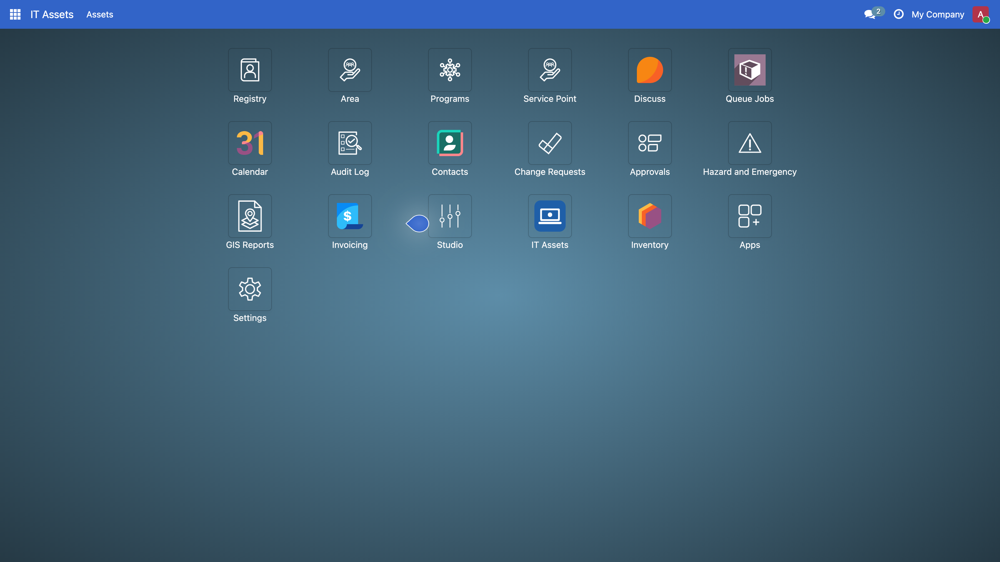

<!-- _class: lead -->
<!-- _paginate: false -->

# Module 3

## Introduction to Odoo

OpenSPP and Odoo Foundations Training, Day 2, 8:30 to 10:00

Edwin Gonzales, OpenSPP

---

## Before we start

```bash
./odoo-project start
```

Log in with `admin` / `admin`. Settings, scroll to the bottom, **Activate the developer mode**.

Then wait. Nothing in the next twenty minutes needs your laptop.

---

## By ten you can

1. Say what Odoo is and name the three parts of MVC in Odoo terms.
2. Say what a module is and name the role of each file in one.
3. Write a model with Char, Selection, Date, Many2one and Boolean fields: "model = table, field = column".
4. Write a list view, a form view, an action and a menu: menu, action, view, model.
5. Write the access row a new model needs, and recognise its absence in the log and on screen.
6. Use the ORM from a method and from the shell; add a PDF report.
7. Run `./odoo-project test dswd_asset` and read the summary line.

And at ten you learn why you will almost never build a module this way for 4Ps.

---

## What Odoo is

- Python on PostgreSQL, web client in JavaScript. 2005 TinyERP, 2008 OpenERP, 2014 Odoo.
- One major release a year. This training: **Odoo 19** (2025).
- **Community** edition, LGPL v3: what OpenSPP builds on and what you run. Enterprise: proprietary modules on top.
- Everything is a module, including the core. A module adds tables, columns, screens, menus, reports and rules to other
  modules **without changing their code**.
- OpenSPP: about a hundred `spp_*` modules on Odoo. Your `dswd_*` modules: on top of those.

---

## MVC, in Odoo terms

| MVC        | In Odoo                                                              | You write it in               |
| ---------- | -------------------------------------------------------------------- | ----------------------------- |
| Model      | `models.Model` classes and fields; the ORM maps them to tables       | `models/*.py`                 |
| View       | XML on `ir.ui.view` (list, form, search), QWeb templates for reports | `views/*.xml`, `report/*.xml` |
| Controller | actions and menus route clicks; model methods run the logic          | `views/*.xml`, `models/*.py`  |

Data and rules in the model. Drawing in the view. The controller stays thin: a button calls a method, the method uses
the ORM, the view only says where the button sits.

---

## Odoo in five words

| Word   | Means                                                | See it at                     |
| ------ | ---------------------------------------------------- | ----------------------------- |
| Module | a folder with `__manifest__.py` on the addons path   | Apps                          |
| Model  | a table: `_name = "dswd.asset"` becomes `dswd_asset` | Settings > Technical > Models |
| Field  | a column with a type                                 | Settings > Technical > Fields |
| View   | how the table is drawn: list, form, search           | Settings > Technical > Views  |
| Menu   | menu, then action, then view, then model             | the top bar and the app tiles |

Look at `res.partner` under Models: fields from `base`, from `spp_registry`, from `spp_vocabulary`. **Many modules add
columns to one table.** Hold that thought until 10:30.

---

## What we build: an IT asset register


---

## Step 0: a module is a folder and a manifest

```python
{
    "name": "DSWD Training: IT Asset Register",
    "category": "DSWD 4Ps/Training",
    "version": "19.0.1.0.0",
    "license": "LGPL-3",
    "depends": ["base", "spp_security"],
    "data": ["security/ir.model.access.csv"],
    "installable": True,
    "auto_install": False,
}
```

Odoo needs a folder and a manifest, nothing more. The `dswd_` prefix is **our** project's rule, the way `spp_` is
OpenSPP's: it says who owns the code, not what it is about.

**Install now:** `./odoo-project install dswd_asset`

---

## Step 1: the model is the table

```python
class DswdAsset(models.Model):
    _name = "dswd.asset"
    _description = "IT Asset"

    name = fields.Char(string="Asset Tag", required=True)
    model_name = fields.Char(string="Make and Model")
    asset_type = fields.Selection(
        [("laptop", "Laptop"), ("desktop", "Desktop"), ("printer", "Printer"), ("other", "Other")],
        required=True, default="laptop",
    )
    custodian_id = fields.Many2one("res.users", string="Custodian", default=lambda self: self.env.user)
    purchase_date = fields.Date()
    warranty_end_date = fields.Date()
    is_in_use = fields.Boolean(default=True)
    is_under_warranty = fields.Boolean(compute="_compute_is_under_warranty")
```

**Predict**: Region IV buys tablets. What do we change?

---

## Computed and constrained

```python
    @api.depends("warranty_end_date")
    def _compute_is_under_warranty(self):
        today = fields.Date.context_today(self)
        for asset in self:
            asset.is_under_warranty = bool(asset.warranty_end_date and asset.warranty_end_date >= today)

    @api.constrains("purchase_date", "warranty_end_date")
    def _check_warranty_after_purchase(self):
        for asset in self:
            if asset.purchase_date and asset.warranty_end_date and asset.warranty_end_date < asset.purchase_date:
                raise ValidationError(_("The warranty end date must be on or after the purchase date."))
```

A computed field is never typed in; it is not stored, so it cannot be searched. A constraint refuses bad data with a
sentence the user reads.

---

## After step 1: a table, no door


---

## The warning you will meet again

```
WARNING odoo.modules.loading: The models ['dswd.asset'] have no access rules in module dswd_asset,
consider adding some
```

Nothing is broken yet. Nobody can open the table either. Remember this line: in fifteen minutes it becomes an error on
screen.

---

## Step 2: views draw the table, a menu opens it

```xml
<record id="view_dswd_asset_list" model="ir.ui.view">
    <field name="name">dswd.asset.list</field>
    <field name="model">dswd.asset</field>
    <field name="arch" type="xml">
        <list>
            <field name="name" />
            <field name="asset_type" />
            <field name="custodian_id" widget="many2one_avatar_user" />
            <field name="is_under_warranty" />
        </list>
    </field>
</record>

<record id="action_dswd_asset" model="ir.actions.act_window">
    <field name="name">IT Assets</field>
    <field name="res_model">dswd.asset</field>
    <field name="view_mode">list,form</field>
</record>

<menuitem id="menu_dswd_asset_root" name="IT Assets" web_icon="dswd_asset,static/description/icon.png" />
<menuitem id="menu_dswd_asset" name="Assets" parent="menu_dswd_asset_root" action="action_dswd_asset" />
```

Odoo 19: `<list>`, not `<tree>`. **Predict**: where will it appear?

---

## After step 2: the app tile



---

## The warning became an error


---

## Step 3: groups and access rows

```xml
<record id="group_asset_officer" model="res.groups">
    <field name="name">IT Assets: Officer</field>
    <field name="privilege_id" ref="privilege_asset_officer" />
    <field name="implied_ids" eval="[Command.link(ref('group_asset_viewer'))]" />
</record>

<record id="spp_security.group_spp_admin" model="res.groups">
    <field name="implied_ids" eval="[Command.link(ref('group_asset_manager'))]" />
</record>
```

```csv
id,name,model_id:id,group_id:id,perm_read,perm_write,perm_create,perm_unlink
access_dswd_asset_system,dswd.asset system,model_dswd_asset,base.group_system,1,1,1,1
access_dswd_asset_viewer,dswd.asset viewer,model_dswd_asset,group_asset_viewer,1,0,0,0
access_dswd_asset_officer,dswd.asset officer,model_dswd_asset,group_asset_officer,1,1,1,0
access_dswd_asset_manager,dswd.asset manager,model_dswd_asset,group_asset_manager,1,1,1,1
```

Viewer reads. Officer reads, writes, creates. Manager also deletes. The last record is why `admin` can open it.

---

## Your turn: register the laptop in front of you


Then set a warranty end date **before** the purchase date, and read the dialog.

---

## Step 4: a test says what "working" means

```python
@tagged("post_install", "-at_install")
class TestDswdAsset(TransactionCase):
    def setUp(self):
        super().setUp()
        self.asset = self.env["dswd.asset"].create({"name": "LT-0001"})

    def test_warranty_before_purchase_is_refused(self):
        with self.assertRaises(ValidationError):
            self.asset.write({"purchase_date": "2026-01-10", "warranty_end_date": "2025-12-31"})
```

```
$ ./odoo-project test dswd_asset
0 failed, 0 error(s) of 12 tests
```

The access tests log in as a viewer, an officer and a manager. The rows are proven, not assumed.

**Start yours now** and read the summary line at 9:54.

---

## Step 5: the ORM, in a method

```python
    def action_assign_to_me(self):
        self.write({"custodian_id": self.env.user.id})

    @api.model
    def find_warranty_expiring(self, days=30):
        today = fields.Date.context_today(self)
        return self.search(
            [("is_in_use", "=", True), ("warranty_end_date", ">=", today),
             ("warranty_end_date", "<=", fields.Date.add(today, days=days))],
            order="warranty_end_date",
        )
```

```xml
<header>
    <button name="action_assign_to_me" type="object" string="Assign to me" class="btn-primary" />
</header>
```

No decorator: `self` is the record. `@api.model`: works on the whole table. `search`, `create`, `write`, `unlink`.

---

## Step 5: the ORM, in the shell

```
$ ./odoo-project shell
>>> Asset = env["dswd.asset"]
>>> Asset.search_count([])
2
>>> Asset.search([("asset_type", "=", "laptop")]).mapped("name")
['LT-0001']
>>> a = Asset.create({"name": "LT-0099"})
>>> a.write({"model_name": "Lenovo ThinkPad T14"})
>>> a.custodian_id.name
'OdooBot'
>>> Asset.find_warranty_expiring(365).mapped("name")
['LT-0001']
>>> a.unlink(); env.cr.commit()
```

A Many2one is itself a record: `a.custodian_id.name` walks the link. Nothing is saved until `env.cr.commit()`.

---

## Step 6: a PDF report

```xml
<record id="action_report_dswd_asset" model="ir.actions.report">
    <field name="name">Asset Sheet</field>
    <field name="model">dswd.asset</field>
    <field name="report_type">qweb-pdf</field>
    <field name="report_name">dswd_asset.report_dswd_asset</field>
    <field name="binding_model_id" ref="model_dswd_asset" />
</record>

<template id="report_dswd_asset">
    <t t-call="web.html_container">
        <t t-foreach="docs" t-as="asset">
            <t t-call="web.external_layout">
                <div class="page">
                    <h2>Asset Sheet: <span t-field="asset.name" /></h2>
                    <table class="table table-sm">
                        <tr><th>Custodian</th><td><span t-field="asset.custodian_id" /></td></tr>
                        <tr><th>Warranty End</th><td><span t-field="asset.warranty_end_date" /></td></tr>
                    </table>
                </div>
            </t>
        </t>
    </t>
</template>
```

`binding_model_id` puts it in the Print menu. `docs` is what is being printed. HTML, then PDF.

---

## The four mistakes of a new module

| Mistake                                      | Symptom                                                     | Look at                                    |
| -------------------------------------------- | ----------------------------------------------------------- | ------------------------------------------ |
| No access row                                | `have no access rules`; `AccessError` even as admin         | `security/ir.model.access.csv`             |
| Action without a menu, menu without action   | clean update, nothing to click                              | Technical > Menu Items                     |
| A view field that is not on the model        | `Field "x" does not exist in model "dswd.asset"`            | Technical > Fields                         |
| `_name` versus `model_id` in the access file | `No matching record found for external id 'model_dswd_...'` | `model_` plus `_name`, dots to underscores |

---

## The question

4Ps needs a well-being level on every household.

**Which file do we start with?**

---

## The household table already exists


310 columns, from several modules. A new `dswd.household` would mean two tables, two forms, two access files, and no
link to programs. At ten you add **one column** to this table instead.

---

## The tablet, resolved

```python
    asset_type = fields.Selection(
        [("laptop", "Laptop"), ("desktop", "Desktop"), ("printer", "Printer"), ("tablet", "Tablet"), ("other", "Other")],
    )
```

One word cost: a code change, a release, an `update` on every server.

In OpenSPP a code list is **data**: Settings > Vocabularies. That is the first file you see at ten.

---

## Today and at ten: the same files, three swaps

| Today, `dswd_asset`                    | Next, `dswd_wellbeing`                                              |
| -------------------------------------- | ------------------------------------------------------------------- |
| `_name = "dswd.asset"`, a new table    | `_inherit = "res.partner"`, columns on an existing table            |
| `asset_type = fields.Selection([...])` | `dswd_well_being_level_id = fields.Many2one("spp.vocabulary.code")` |
| `<list>` and `<form>` from scratch     | `inherit_id` plus one XPath on a named anchor                       |
| an action and a menu you created       | no menu: the household form already has one                         |
| groups and four access rows            | access file: header only                                            |
| `depends = ["base", "spp_security"]`   | `depends = ["spp_registry", "spp_vocabulary"]`                      |

Same files, same loop, same `test`. Three swaps, each one line. See you at ten.
