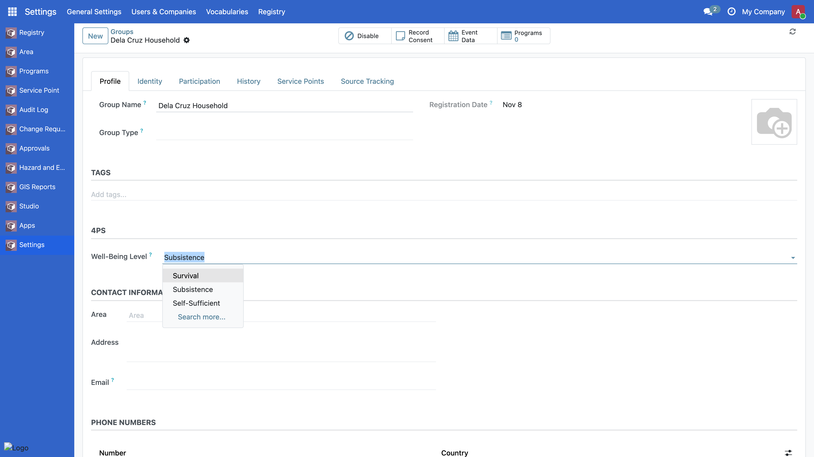
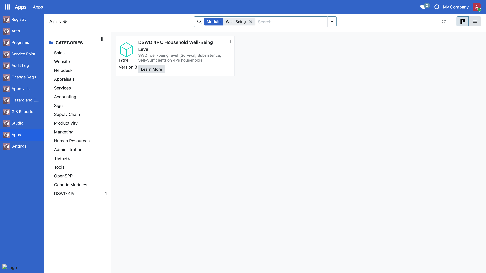
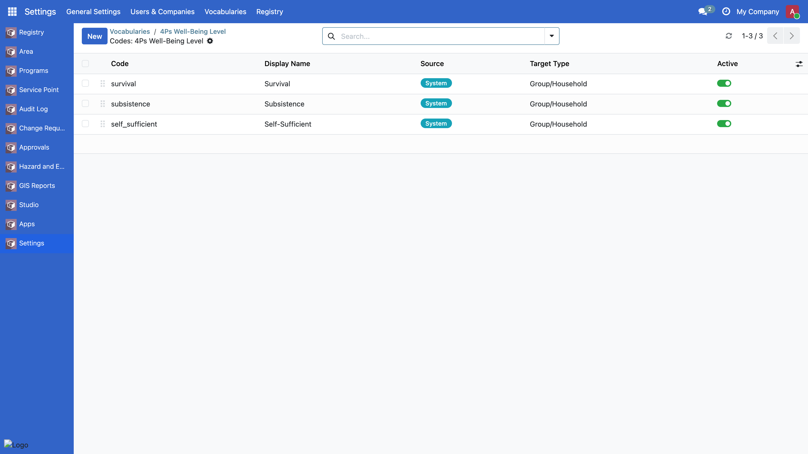
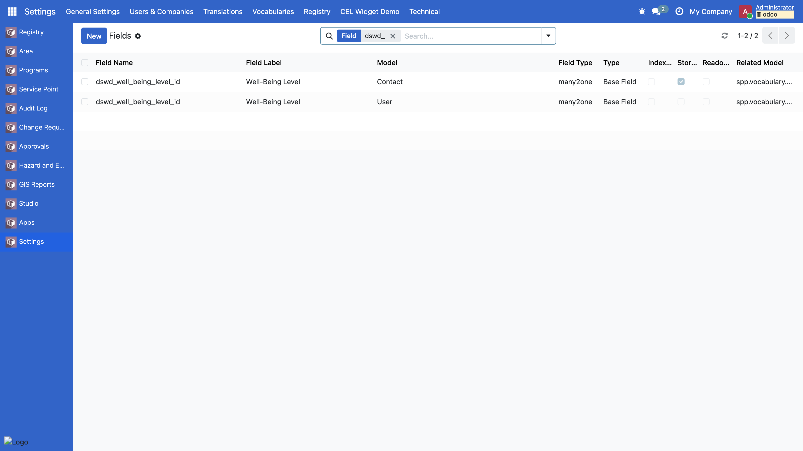
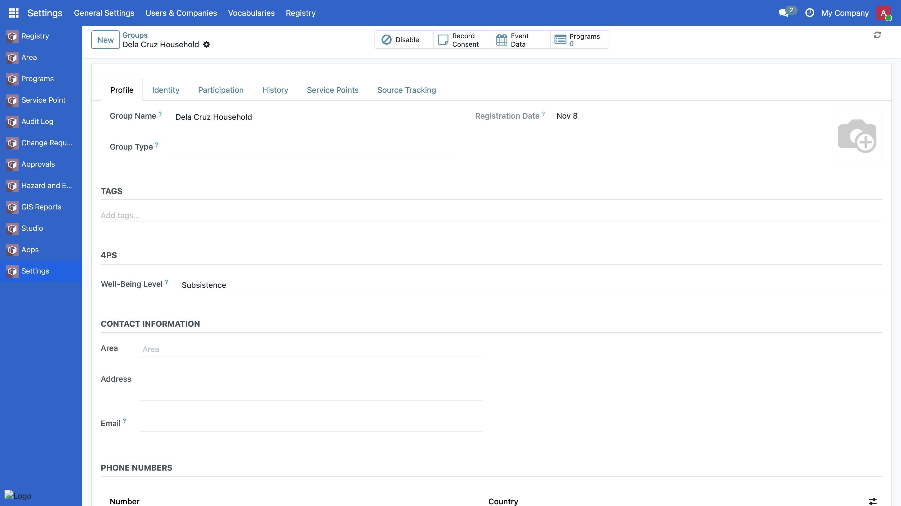

<!-- _class: lead -->
<!-- _paginate: false -->

# Module 4

## Developing Custom Modules and Extending Odoo Models

OpenSPP and Odoo Foundations Training, Day 2, 10:00 to 12:00

Edwin Gonzales, OpenSPP

---

## By noon you can

1. Name the role of every file in a `dswd_*` module, and say why a file not in the manifest does not exist.
2. Pick the right pattern for a 4Ps requirement: inherit the upstream model, prefix the field `dswd_`, point it at a
   vocabulary code.
3. Explain how a view is extended, and recognise the error when the anchor is wrong.
4. Read a log excerpt and say which file to open.
5. Run a module's tests and read the summary line.

Nothing today needs your laptop. Read, predict, diagnose. Keyboard time is Day 3.

---

## The requirement

The SWDI assessment places every 4Ps household at one of three levels:

| Level | Code              | Meaning                                    |
| ----- | ----------------- | ------------------------------------------ |
| 1     | `survival`        | cannot meet basic needs without assistance |
| 2     | `subsistence`     | meets basic needs, no buffer               |
| 3     | `self_sufficient` | can sustain itself, may exit the program   |

Since EO 120 (July 2026) the level decides whether a household stays past seven years.

**Today**: put that level on the household record in OpenSPP, as a dropdown on the Profile page.

---

## What you will see at noon



---

## Where this lives in production

The production 4Ps registry module ships **26 vocabularies** the same way:

- `urn:dswd:4ps:client-status` (32 statuses in 9 categories)
- `urn:dswd:4ps:set-group` (`1A` to `12V`)
- `urn:dswd:4ps:ip-group` (about 2,000 codes)
- `urn:dswd:4ps:well-being-level` (the one we build)

Household fields are `Many2one` to `spp.vocabulary.code`, exactly like ours.

Module 5 this afternoon shows them. Module 4 builds the smallest one.

---

## Anatomy of a module

```
dswd_wellbeing/
├── __manifest__.py                        declares the module, lists the files
├── __init__.py                            imports models
├── data/vocabulary_well_being_level.xml   the vocabulary and its three codes
├── models/__init__.py                     imports res_partner
├── models/res_partner.py                  the field on the household
├── views/res_partner_views.xml            where the field shows
├── security/ir.model.access.csv           access rows (none today: no new model)
├── tests/test_wellbeing.py                what "working" means
└── readme/DESCRIPTION.md                  what the module is for
```

Fill in section 2 of your handout as we go.

---

## The three rules

1. **Never edit `vendor/openspp/`.** Read it. Extend it from your module. The next release overwrites it.

2. **Inherit, do not redefine.** `_inherit = "res.partner"` adds to the household. `_name` would create a new table. New
   fields on upstream models start with `dswd_`.

3. **A file not listed in `__manifest__.py` does not exist.** No error. Just absence.

---

## Step 0: the manifest

```python
{
    "name": "DSWD 4Ps: Household Well-Being Level",
    "category": "DSWD 4Ps/Registry",
    "version": "19.0.1.0.0",
    "author": "DSWD",
    "license": "LGPL-3",
    "depends": ["spp_registry", "spp_vocabulary"],
    "data": [
        "security/ir.model.access.csv",
    ],
    "installable": True,
}
```

Installable, does nothing. **Predict**: where will it appear after we install it?

---

## After step 0: Apps knows the module



---

## The loop

| You changed                                       | Run                                     |
| ------------------------------------------------- | --------------------------------------- |
| Nothing yet, new module                           | `./odoo-project install dswd_wellbeing` |
| A method body, an existing view                   | nothing, the dev server reloads         |
| Manifest, data, security, a new field, a new view | `./odoo-project update`                 |
| A record in a `noupdate="1"` file                 | delete the record, or a fresh database  |
| A test                                            | `./odoo-project test dswd_wellbeing`    |

`update` **cannot install** a new module. `./odoo-project logs` is where errors live.

---

## Step 1: the vocabulary

```xml
<odoo noupdate="1">
    <record id="vocab_well_being_level" model="spp.vocabulary">
        <field name="name">4Ps Well-Being Level</field>
        <field name="namespace_uri">urn:dswd:4ps:well-being-level</field>
        <field name="is_system" eval="True" />
        <field name="domain">social_assistance</field>
    </record>

    <record id="code_well_being_survival" model="spp.vocabulary.code">
        <field name="vocabulary_id" ref="vocab_well_being_level" />
        <field name="code">survival</field>
        <field name="display">Survival</field>
        <field name="sequence">10</field>
    </record>
</odoo>
```

**Predict**: after `update`, where will the three codes show?

---

## After step 1: Settings > Vocabularies



---

## Why a vocabulary and not a `Selection`

```python
# Not this
level = fields.Selection([("1", "Survival"), ("2", "Subsistence"), ("3", "Self-Sufficient")])
```

- A code list changes without a release: Settings > Vocabularies, no code change.
- Deployments differ: a region can hide codes with a deployment profile.
- Every code has a URI (`urn:dswd:4ps:well-being-level#survival`) other systems can match.
- 32 client statuses, 2,000 IP groups: nobody wants those in Python.

Static selections are for internal workflow states only.

---

## Step 2: the field

```python
from odoo import fields, models

WELL_BEING_NAMESPACE = "urn:dswd:4ps:well-being-level"


class ResPartner(models.Model):
    _inherit = "res.partner"

    dswd_well_being_level_id = fields.Many2one(
        comodel_name="spp.vocabulary.code",
        string="Well-Being Level",
        domain=[("namespace_uri", "=", WELL_BEING_NAMESPACE)],
        ondelete="restrict",
    )
```

Plus `from . import res_partner` in `models/__init__.py`. **Predict**: after `update`, what changes on screen?

---

## The silent failure

`models/res_partner.py` is perfect. `update` says nothing. The field is nowhere.

```python
# models/__init__.py
from . import res_partner      # <- the line that was missing
```

Python never imported the file, so Odoo never saw the class.

Where to look: **Settings > Technical > Fields**, search `dswd_`.

A field without a view is invisible, not broken.

---

## Where a field without a view shows up



---

## Step 3: the view

```xml
<record id="view_res_partner_form_wellbeing" model="ir.ui.view">
    <field name="name">res.partner.form.dswd.wellbeing</field>
    <field name="model">res.partner</field>
    <field name="inherit_id" ref="spp_registry.view_individuals_form" />
    <field name="arch" type="xml">
        <xpath expr="//group[@name='group_tags_section']" position="after">
            <group name="dswd_4ps_section" string="4Ps">
                <field name="dswd_well_being_level_id" options="{'no_create': True, 'no_open': True}" />
            </group>
        </xpath>
    </field>
</record>
```

Find the anchor first: `grep -n 'name="group_' vendor/openspp/spp_registry/views/individual_views.xml`

---

## After step 3: the household Profile page



---

## Reading an error, bottom up

```
ValueError: Wrong value for spp.vocabulary.domain: 'administrative'
odoo.tools.convert.ParseError: while parsing
  /mnt/extra-addons/custom/dswd_wellbeing/data/vocabulary_well_being_level.xml:10
```

```
Element '<xpath expr="//group[@name='group_tag_section']">' cannot be located in parent view
View error context: {'xmlid': 'view_res_partner_form_wellbeing', ...}
```

1. Find the first line that names a file in **your** module.
2. Open that file at that line.
3. Compare against the upstream definition (the selection, the view).

Lint passed on both. Lint checks shape, not meaning.

---

## Steps 4 and 5: the tests

```python
@tagged("post_install", "-at_install")
class TestHouseholdWellBeing(RegistryCommon):
    def test_household_stores_a_level(self):
        subsistence = self.VocabCode.get_code(NAMESPACE, "subsistence")
        self.group.dswd_well_being_level_id = subsistence
        self.assertEqual(self.group.dswd_well_being_level_id.display, "Subsistence")
```

```
$ ./odoo-project test dswd_wellbeing
0 failed, 0 error(s) of 5 tests
Full log: .../dswd_wellbeing_unittest_20261108_110619.log
```

The summary line is the first thing you read when someone says "the module is broken".

A `Many2one` `domain` only filters the dropdown: step 5 adds an `@api.constrains` so code and the API are guarded too.

---

## Claude Code: the review is the job

Ask: _"Add a fourth well-being level, `graduated`, sequence 40, and a test that it resolves."_

Then read the diff before running anything:

- Is the new record in the right file, under the right vocabulary?
- Is the file still listed in the manifest?
- Does the test assert something that could fail?

Run the tests. Keep or discard. The tool types; you decide.

---

## The five mistakes

| Mistake                                        | Symptom                            | Look at                                    |
| ---------------------------------------------- | ---------------------------------- | ------------------------------------------ |
| Data file not in the manifest                  | clean update, nothing appears      | `grep` the manifest                        |
| Invalid value in a data file                   | `ParseError`, registry fails       | the upstream field definition              |
| Import missing in `models/__init__.py`         | no error, field absent             | Settings > Technical > Fields              |
| XPath anchor misspelled                        | `cannot be located in parent view` | `grep 'name="group_'` in the upstream view |
| `restart` instead of `update`, `noupdate` data | change never shows                 | the loop table                             |

Drill time: three real excerpts, in pairs, 12 minutes.

---

## Recap, and what comes next

**Today**: manifest, data, model, view, security, tests. Inherit, prefix, point at a vocabulary. Read errors bottom up.
Run the tests.

**Module 5 (this afternoon)**: new models and menus, groups and record rules, hierarchical vocabularies (the 32
statuses), programs and cycles, change requests, the production module map.

**Module 6 (Day 3)**: your hands on the keyboard.

```bash
git checkout m4-step-5 && ./odoo-project start && ./odoo-project install dswd_wellbeing
```

No Docker on your laptop? Tier 1 of the Day 3 exercise needs only the folder and your eyes. Lunch triage table today.
